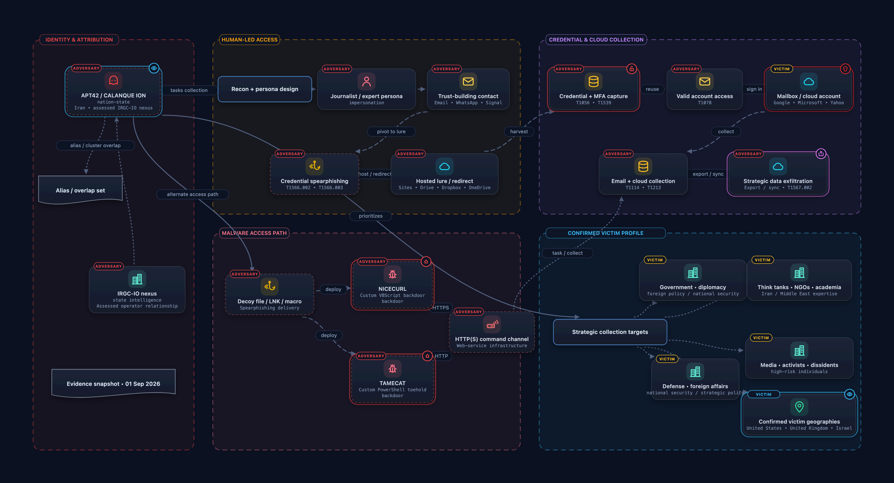

<p align="center">
  <a href="APT42_Threat_Actor_Analysis.svg"></a>
</p>

<h1 align="center">APT42 Threat Actor Analysis</h1>

<p align="center">Interactive defensive-intelligence visualization of APT42 / CALANQUE ION.</p>

<p align="center">
  
  
  
  <a href="https://prank1004.github.io/apt42-netdraw-analysis/"></a>
</p>

<p align="center">
  <a href="https://prank1004.github.io/apt42-netdraw-analysis/">Live viewer</a> ·
  <a href="#scope-and-caveat">Scope</a> ·
  <a href="#what-the-graph-shows">What the graph shows</a> ·
  <a href="#attck-techniques">ATT&amp;CK techniques</a> ·
  <a href="#open-the-viewer">View locally</a> ·
  <a href="#public-references">References</a>
</p>

---

The graph maps how APT42 moves from identity and social engineering to either credential theft with cloud collection or a malware-backed foothold, and which victim profiles public first-party reporting confirms. It is an analytical visualization, not an IOC feed. Click the image above to open the scalable SVG, or use the live viewer for chapter-by-chapter navigation.

## Scope and caveat

> [!IMPORTANT]
> The graph separates human-led credential operations from malware-enabled access and collection. Victim geography is limited to countries explicitly identified in the cited public reporting: the United States, United Kingdom and Israel. Impersonated brands are not treated as victims. The IRGC-IO relationship is a high-confidence assessment; vendor alias scopes are not perfectly identical. Alias equivalence, victim geography and infrastructure attribution remain evidence-graded.
>
> The content is intended for defensive analysis and awareness.

## Open the viewer

The published viewer is at **https://prank1004.github.io/apt42-netdraw-analysis/**. It loads `APT42_Threat_Actor_Analysis.svg` with `fetch()`, so opening `index.html` from a `file://` path shows "The intelligence map could not be loaded." Serve the folder over HTTP instead:

```bash
git clone https://github.com/Prank1004/apt42-netdraw-analysis.git
cd apt42-netdraw-analysis
python3 -m http.server 8000
# then open http://localhost:8000/
```

| Control | Action |
|---|---|
| Chapter buttons (bottom dock) | Overview · Attribution · Social engineering · Credential path · Malware path · Victim profile |
| Keys `0` and `1`–`5` | `0` returns to the overview; `1`–`5` jump to the five chapters in the order above |
| `Esc` | Collapses the analytic-summary card when not in fullscreen (the `i` button reopens it) |
| Mouse wheel | Zoom around the pointer |
| Drag | Pan the map |
| Double-click | Reset to the overview |
| `+` / `−` buttons | Zoom in / zoom out |
| Fullscreen button (`⛶`) | Enter or leave fullscreen |
| Hover a node | Tooltip with a short analytic note on key nodes (11 of the 24) |
| Header links | Download the source JSON or export the SVG |

## What the graph shows

24 nodes and 24 edges are arranged in five zones. A six-step guided journey walks from attribution through the two access paths to the confirmed victim profile. Solid links denote well-supported relationships, dashed links observed operational flow, and dotted links assessed overlap or contextual relevance.

| Zone | Covers |
|---|---|
| Identity &amp; attribution | APT42 / CALANQUE ION, Alias / overlap set, IRGC-IO nexus, Evidence snapshot • 01 Sep 2026 |
| Human-led access | Recon + persona design, Journalist / expert persona, Trust-building contact, Credential spearphishing, Hosted lure / redirect |
| Credential &amp; cloud collection | Credential + MFA capture, Valid account access, Mailbox / cloud account, Email + cloud collection, Strategic data exfiltration |
| Malware access path | Decoy file / LNK / macro, NICECURL, TAMECAT, HTTP(S) command channel |
| Confirmed victim profile | Strategic collection targets, Government • diplomacy, Think tanks • NGOs • academia, Media • activists • dissidents, Defense • foreign affairs, Confirmed victim geographies |

The malware branch (NICECURL, a custom VBScript backdoor, and TAMECAT, a custom PowerShell toehold) is the alternative to credential-only operations. The four victim-sector nodes are government and diplomacy; think tanks, NGOs and academia; media, activists and dissidents; and defense and foreign affairs. The evidence snapshot is dated 01 Sep 2026 and rests on public first-party reporting.

## ATT&CK techniques

The source JSON references 12 distinct MITRE ATT&amp;CK technique IDs. Names are not stored in the JSON except for T1656 (Impersonation), so only IDs are listed.

<details>
<summary>Technique to graph node mapping (12 IDs)</summary>

| Technique | Graph node(s) |
|---|---|
| T1056 | Credential + MFA capture |
| T1059.001 | TAMECAT |
| T1059.005 | NICECURL |
| T1071.001 | NICECURL · TAMECAT |
| T1078 | Valid account access |
| T1114 | Email + cloud collection |
| T1213 | Email + cloud collection |
| T1539 | Credential + MFA capture |
| T1566.002 | Credential spearphishing |
| T1566.003 | Credential spearphishing |
| T1567.002 | Strategic data exfiltration |
| T1656 (Impersonation) | Journalist / expert persona |

</details>

## Repository files

| Path | Purpose |
|---|---|
| `index.html` | GitHub Pages viewer with pan and zoom, chapter navigation, tooltips and an analytic-summary card |
| `APT42_Threat_Actor_Analysis.netdraw.json` | Editable source for NetDraw: 5 zones, 24 nodes, 24 edges and the 6-step journey |
| `APT42_Threat_Actor_Analysis.svg` | Scalable rendered diagram (1890 × 1024, viewBox `-40 -4 1890 1024`); fetched by the viewer at runtime |
| `APT42_Threat_Actor_Analysis.png` | High-resolution preview (3780 × 2048, ~693 KB); also the viewer's `og:image` |
| `.nojekyll` | Disables Jekyll processing so GitHub Pages serves the files as they are |

## Public references

| Title | Publisher | Link |
|---|---|---|
| APT42: Crooked Charms, Cons, and Compromises | Google Cloud | [cloud.google.com](https://cloud.google.com/blog/topics/threat-intelligence/apt42-charms-cons-compromises) |
| Uncharmed: Untangling Iran's APT42 Operations | Google Cloud | [cloud.google.com](https://cloud.google.com/blog/topics/threat-intelligence/untangling-iran-apt42-operations) |
| Iranian backed group steps up phishing campaigns against Israel, U.S. | Google Threat Analysis Group | [blog.google](https://blog.google/threat-analysis-group/iranian-backed-group-steps-up-phishing-campaigns-against-israel-us/) |
| Educated Manticore Reemerges | Check Point | [blog.checkpoint.com](https://blog.checkpoint.com/security/educated-manticore-reemerges-iranian-spear-phishing-campaign-targeting-high-profile-figures/) |
